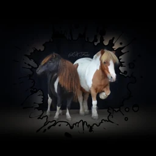
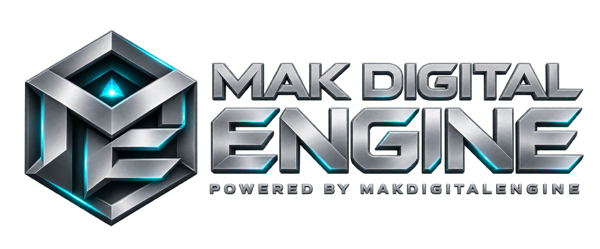

# Small ideas. Entire worlds.

**Independent apps. Original games. Technology of our own.**

[Website](https://makdigitalstudio.com/) · [Discord](https://discord.gg/BMKurgjaCa) · [Contact](mailto:support@makdigitalstudio.com) · [Deutsch](#deutsch)

---

## One studio. A world of possibilities.

MAK Digital Studio is the home of apps, games and developer technology by **Makenci**. From everyday horse care to colourful puzzles and distant galaxies, each project has its own identity.

### Explore the projects

<table>
<tr>
<td valign="top" width="50%">

<h3>PferdePass</h3>

Horse profiles, health records, appointments and a stable journal. Everyday organisation, with horse data stored locally.

<strong>Development complete · Google Play testing</strong>

<a href="https://pferdepass.makdigitalstudio.com/">Website · DE / EN ↗</a>

</td>
<td valign="top" width="50%">

<h3>Doggy Pixel Eaters</h3>

A Chihuahua pack, colourful food pixels and puzzles that reward the right order. Small paws. Big puzzle appetite.

<strong>Android · In development</strong>

<a href="https://doggypixeleaters.makdigitalstudio.com/">Website ↗</a> · <a href="https://discord.gg/TRqu25YKKy">Discord ↗</a>

</td>
</tr>
<tr>
<td valign="top" width="50%">

<h3>Hero Fighters</h3>

Heroes, monsters and a fantasy adventure, supported by dedicated tools for creating its world.

<strong>Android · In development</strong>

<a href="https://herofighters.makdigitalstudio.com/">Website ↗</a> · <a href="https://discord.gg/hNqGumXM9M">Discord ↗</a>

</td>
<td valign="top" width="50%">

<h3>Idle Galaxy Space Ship Fighters</h3>

Space combat, ship equipment, loot and idle progression. An adventure beyond the next star.

<strong>Android · In development</strong>

<a href="https://idlegalaxyspaceshipfighters.makdigitalstudio.com/">Website ↗</a> · <a href="https://discord.gg/7RcXRxUw4E">Discord ↗</a>

</td>
</tr>
</table>

### MakDigitalEngine · Building the foundation

An independently developed, modular **C++23 foundation for 2.5D games**: geometry, timing, sprites, text, UI and resource mechanisms.

**Status: experimental prototype in active development.** Portable Windows tests have passed for a documented revision; newer additions still require validation. Android/GPU validation and integration into games remain open. The current games do not yet depend on this engine.

### Built with care

**C++23 · Android · Qt / QML · OpenGL ES · Native tools**

We develop across the whole project: application code, interfaces, content tools and supporting systems. **The source repositories remain private.** This profile introduces the work; it is not a public source-code or download catalogue.

---

## Deutsch

### Ein Studio. Viele eigene Welten.

**MAK Digital Studio** ist das Zuhause der Apps, Spiele und Entwicklertechnik von **Makenci**. Jedes Projekt bekommt seinen eigenen Charakter – von praktischer Hilfe im Pferdealltag bis zu bunten Puzzlewelten und Weltraumabenteuern.

| Projekt | Idee | Aktueller Stand |
| --- | --- | --- |
| [PferdePass](https://pferdepass.makdigitalstudio.com/) | Pferdeprofile, Gesundheit, Termine und Stallbuch | Entwicklung abgeschlossen · Google-Play-Testphase |
| [Doggy Pixel Eaters](https://doggypixeleaters.makdigitalstudio.com/) | Chihuahua-Rudel und bunte Pixelpuzzles | In Entwicklung |
| [Hero Fighters](https://herofighters.makdigitalstudio.com/) | Helden, Monster und Fantasy-Abenteuer | In Entwicklung |
| [Idle Galaxy Space Ship Fighters](https://idlegalaxyspaceshipfighters.makdigitalstudio.com/) | Raumkämpfe, Ausrüstung und Idle-Fortschritt | In Entwicklung |

**MakDigitalEngine** ist unsere eigene modulare C++23-Grundlage für 2.5D-Spiele. Der experimentelle Prototyp umfasst unter anderem Sprites, Text und UI. Portable Windows-Tests sind für einen dokumentierten Stand bestanden; neuere Erweiterungen brauchen weitere Prüfung. Android-/GPU-Abnahme und Spieleinbindung stehen noch aus. Die bisherigen Spiele verwenden die Engine noch nicht.

**Alle Projekt-Repositories bleiben privat.** Öffentliche Downloads werden erst verlinkt, wenn sie freigegeben sind.

### Deine Community

[MAK Digital Studio](https://discord.gg/BMKurgjaCa) · [Doggy Pixel Eaters](https://discord.gg/TRqu25YKKy) · [Hero Fighters](https://discord.gg/hNqGumXM9M) · [Idle Galaxy](https://discord.gg/7RcXRxUw4E)

**Kleine Ideen. Große Welten.**

[makdigitalstudio.com](https://makdigitalstudio.com/) · [support@makdigitalstudio.com](mailto:support@makdigitalstudio.com) · [Makenci on GitHub](https://github.com/tomsmulski)

