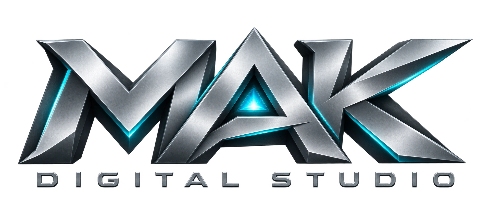
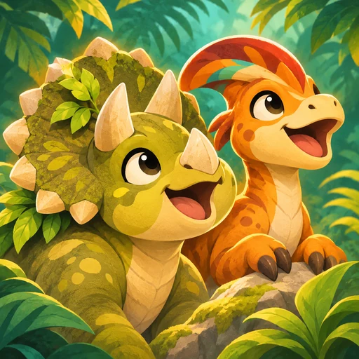
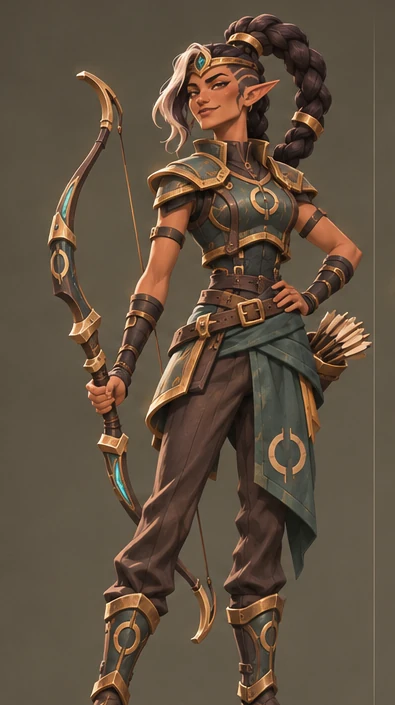
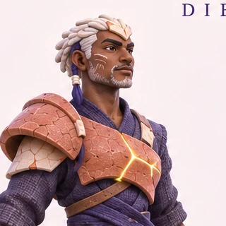

# Small ideas. Entire worlds.

**Independent apps. Original games. Technology of our own.**

[Website](https://makdigitalstudio.com/) · [Discord](https://discord.gg/BMKurgjaCa) · [Contact](mailto:support@makdigitalstudio.com) · [Deutsch](#deutsch)

---

## One studio. A world of possibilities.

MAK Digital Studio is the home of apps, games and developer technology by **Makenci**. From everyday horse care to colourful puzzles and distant galaxies, each project has its own identity.

### Explore the projects

<table>
<tr>
<td valign="top" width="50%">

<h3>PferdePass</h3>

Horse profiles, health records, appointments and a stable journal. Everyday organisation, with horse data stored locally.

<strong>Development complete · Google Play testing</strong>

<a href="https://pferdepass.makdigitalstudio.com/">Website ↗</a>

</td>
<td valign="top" width="50%">

<h3>Doggy Pixel Eaters</h3>

A Chihuahua pack, colourful food pixels and puzzles that reward the right order. Small paws. Big puzzle appetite.

<strong>Android · Closed Google Play test</strong>

<a href="https://doggypixeleaters.makdigitalstudio.com/">Website ↗</a> · <a href="https://discord.gg/TRqu25YKKy">Discord ↗</a>

To test, <a href="https://groups.google.com/g/doggy-pixel-eaters-tester">join the tester group</a>, then <a href="https://play.google.com/apps/testing/com.makdigitalstudio.doggypixeleaters">join the Google Play test</a> with the same Google account.

</td>
</tr>
<tr>
<td valign="top" width="50%">

<h3>Hero Fighters</h3>

Heroes, monsters and a fantasy adventure, supported by dedicated tools for creating its world.

<strong>Android · In development</strong>

<a href="https://herofighters.makdigitalstudio.com/">Website ↗</a> · <a href="https://discord.gg/hNqGumXM9M">Discord ↗</a>

</td>
<td valign="top" width="50%">

<h3>Idle Galaxy Space Ship Fighters</h3>

Space combat, ship equipment, loot and idle progression. An adventure beyond the next star.

<strong>Android · In development</strong>

<a href="https://idlegalaxyspaceshipfighters.makdigitalstudio.com/">Website ↗</a> · <a href="https://discord.gg/7RcXRxUw4E">Discord ↗</a>

</td>
</tr>
<tr>
<td valign="top" width="50%">

<h3>Aetherion: Rise of Legends</h3>

Build a team of heroes and explore a fantasy world of floating islands in this idle RPG.

<strong>In development</strong>

<a href="https://aetherionriseoflegends.makdigitalstudio.com/">Website ↗</a> · <a href="https://discord.gg/WdHmcqH2TK">Discord ↗</a>

</td>
<td valign="top" width="50%">

<h3>Primalia: Wild Adventures</h3>

Explore a prehistoric fantasy world alongside animal companions.

<strong>In development</strong>

<a href="https://primaliawildadventures.makdigitalstudio.com/">Website ↗</a> · <a href="https://discord.gg/u22hwSzqeb">Discord ↗</a>

</td>
</tr>
<tr>
<td valign="top" width="50%">

<h3>Riftwarden: Endless Siege</h3>

Defend the arena with automatic ranged attacks and upgrade your build between fights.

<strong>In development</strong>

<a href="https://riftwardenendlesssiege.makdigitalstudio.com/">Website ↗</a>

</td>
<td valign="top" width="50%">

<h3>Epochsmith: Idle Evolution</h3>

Forge and compare equipment to develop your character in an idle adventure.

<strong>In development</strong>

<a href="https://epochsmithidleevolution.makdigitalstudio.com/">Website ↗</a>

</td>
</tr>
</table>

### MakDigitalEngine · Building the foundation

An independently developed, modular **C++23 foundation for 2.5D games**: geometry, timing, sprites, text, UI and resource mechanisms.

**In active development.** Windows tests have passed for a documented revision, and a standalone Android debug build has been tested. Epochsmith already uses selected foundation, Android host and OpenGL ES modules.

### Built with care

**C++23 · Android · Qt / QML · OpenGL ES · Native tools**

We build application code, interfaces, content tools and supporting systems. **The project repositories are private.**

---

## Deutsch

### Ein Studio. Viele eigene Welten.

**MAK Digital Studio** ist das Zuhause der Apps, Spiele und Entwicklertechnik von **Makenci**. Jedes Projekt bekommt seinen eigenen Charakter – von praktischer Hilfe im Pferdealltag bis zu bunten Puzzlewelten und Weltraumabenteuern.

| Projekt | Idee | Aktueller Stand |
| --- | --- | --- |
| [PferdePass](https://pferdepass.makdigitalstudio.com/) | Pferdeprofile, Gesundheit, Termine und Stallbuch | Entwicklung abgeschlossen · Google-Play-Testphase |
| [Doggy Pixel Eaters](https://doggypixeleaters.makdigitalstudio.com/) | Chihuahua-Rudel und bunte Pixelpuzzles | Geschlossener Google-Play-Test |
| [Hero Fighters](https://herofighters.makdigitalstudio.com/) | Helden, Monster und Fantasy-Abenteuer | In Entwicklung |
| [Idle Galaxy Space Ship Fighters](https://idlegalaxyspaceshipfighters.makdigitalstudio.com/) | Raumkämpfe, Ausrüstung und Idle-Fortschritt | In Entwicklung |
| [Aetherion: Rise of Legends](https://aetherionriseoflegends.makdigitalstudio.com/) | Idle-RPG mit Heldenteams und schwebenden Inseln | In Entwicklung |
| [Primalia: Wild Adventures](https://primaliawildadventures.makdigitalstudio.com/) | Prähistorisches Fantasy-Abenteuer mit tierischen Begleitern | In Entwicklung |
| [Riftwarden: Endless Siege](https://riftwardenendlesssiege.makdigitalstudio.com/) | Arena-Verteidigung mit automatischen Fernangriffen und Upgrades | In Entwicklung |
| [Epochsmith: Idle Evolution](https://epochsmithidleevolution.makdigitalstudio.com/) | Idle-Abenteuer mit Schmieden, Ausrüstungsvergleich und Charakterentwicklung | In Entwicklung |

**Doggy Pixel Eaters testen** · Tritt zuerst der [Testergruppe](https://groups.google.com/g/doggy-pixel-eaters-tester) bei. Melde dich anschließend mit demselben Google-Konto zum [Google-Play-Test](https://play.google.com/apps/testing/com.makdigitalstudio.doggypixeleaters) an.

**MakDigitalEngine** ist unsere eigene modulare C++23-Grundlage für 2.5D-Spiele. Die Engine ist in aktiver Entwicklung. Für einen dokumentierten Stand sind Windows-Tests bestanden. Ein eigenständiger Android-Debug-Build wurde ebenfalls getestet. Epochsmith nutzt bereits ausgewählte Module für die Grundlage, den Android-Host und OpenGL ES.

**Alle Projekt-Repositories bleiben privat.**

### Deine Community

[MAK Digital Studio](https://discord.gg/BMKurgjaCa) · [Doggy Pixel Eaters](https://discord.gg/TRqu25YKKy) · [Hero Fighters](https://discord.gg/hNqGumXM9M) · [Idle Galaxy](https://discord.gg/7RcXRxUw4E) · [Aetherion](https://discord.gg/WdHmcqH2TK) · [Primalia](https://discord.gg/u22hwSzqeb)

**Kleine Ideen. Große Welten.**

[makdigitalstudio.com](https://makdigitalstudio.com/) · [support@makdigitalstudio.com](mailto:support@makdigitalstudio.com) · [Makenci on GitHub](https://github.com/tomsmulski)

